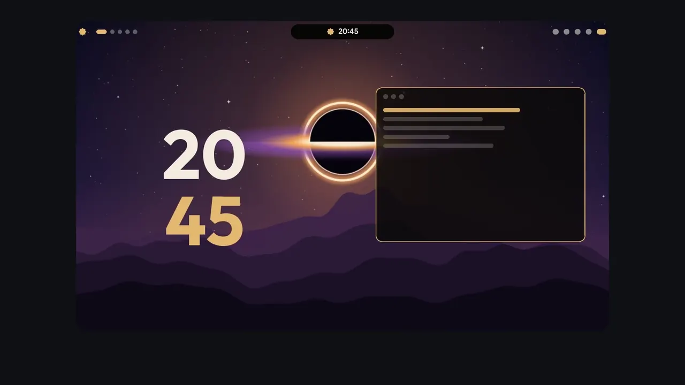

<p align="center">
  <a href="README.md">English</a> · <b>Español</b> · <a href="README.pt.md">Português</a>
</p>

<p align="center">
  
</p>

<p align="center">
  <a href="docs/es/INSTALL.md#sistemas-soportados"></a>
  <a href="docs/es/INSTALL.md#artix-linux-openrc-runit-s6-dinit"></a>
  <a href="docs/es/INSTALL.md#arch-linux-cachyos-endeavouros-garuda"></a>
  <a href="docs/es/INSTALL.md#fedora--nobara"></a>
  <a href="docs/es/INSTALL.md#gentoo"></a>
  <a href="docs/es/INSTALL.md#nixos"></a>
</p>
<p align="center">
  
  
  
</p>
<p align="center">
  <a href="https://github.com/1Shad0w/DarkShadowShell/releases/latest"></a>
  <a href="https://github.com/1Shad0w/DarkShadowShell/releases"></a>
  <a href="https://github.com/1Shad0w/DarkShadowShell/stargazers"></a>
</p>

<p align="center">
  <a href="#instalación-rápida">Instalar</a> ·
  <a href="docs/es/README.md">Docs</a> ·
  <a href="docs/es/FEATURES.md">Funciones</a> ·
  <a href="docs/es/KEYBINDS.md">Atajos</a> ·
  <a href="docs/es/CUSTOMIZE.md">Personalizar</a> ·
  <a href="CONTRIBUTING.md">Contribuir</a>
</p>

---

## En movimiento

<p align="center">
  <a href="https://github.com/shadowww-dev/DarkShadowShell/releases/download/v5.06/darkshadow-showcase.mp4">
    
  </a><br>
  <sub>El dock, widgets, presets, el Centro de actualizaciones y los modos. <a href="https://github.com/shadowww-dev/DarkShadowShell/releases/download/v5.06/darkshadow-showcase.mp4"><b>Ver el vídeo completo con sonido (1:48)</b></a></sub>
</p>

## Sistemas soportados

El shell funciona en **Hyprland (0.55+)** y **niri (25.05+)**, y detecta tu distribución automáticamente:

- **Basadas en Arch**: Arch Linux, CachyOS, EndeavourOS, Garuda, Artix Linux (OpenRC, runit, s6, dinit)
- **Basadas en Fedora**: Fedora, Nobara y Fedora Atomic (Bazzite, Silverblue)
- **Gentoo** (OpenRC o systemd mediante `install/gentoo.sh`)
- **NixOS** (mediante el módulo en `nix/` o flake)

Consulta la tabla completa de compatibilidad, opciones de gestor (`--wm=hyprland|niri|both`) y notas por distro en [docs/es/INSTALL.md](docs/es/INSTALL.md).

## Instalación rápida

Instala con un solo comando (rama estable `main` o rama `dev`), o clona manualmente (evita descargar el ZIP para que `rice-update` pueda actualizarlo); después cierra sesión, elige **Hyprland** o **niri** en la pantalla de inicio de sesión y pulsa `SUPER + U`:

```bash
# Estable (main)
curl -fsSL https://get.aurorian.es/dotfiles | bash

# Desarrollo (dev)
curl -fsSL https://get.aurorian.es/dotfiles-dev | bash
```

<details>
<summary>Clonado manual con git</summary>

```bash
git clone https://github.com/1Shad0w/DarkShadowShell shadows-shell && cd shadows-shell
# Opcional: cambiar a la rama dev -> git checkout dev
./install.sh
```

</details>

> **Actualizar:** Abre **Ajustes → Centro de actualizaciones → Actualizar ahora**, pulsa en la notificación de actualización o ejecuta `rice-update` en una terminal.

## Lo más destacado

- **Barra e Isla Dinámica**: 9 estilos de barra (Dynamic, Flat, Floating, Islands, One island, Frame, etc.), ocultación automática, módulos arrastrables y logo de tu distro.
- **Widgets de escritorio y Vibe**: Widgets con cristal esmerilado Material 3 (reloj, calendario, clima, música, letras, recursos, visualizador de audio, tareas, temporizador y notas) más efectos Vibe reactivos a la música.
- **Temas y apariencia**: 21 esquemas de color (Auto/Gris adaptativos al fondo + paletas curadas), 17 estilos predefinidos en un clic, pantalla de login SDDM y bloqueo en Material 3, y temas comunitarios en **Explorar**.
- **Dock y Lanzador**: Dock lateral o inferior con menú de apps, apps fijadas y controles multimedia; lanzador integrado con 5 temas, calculadora, conversor de unidades/monedas, selector de emojis y buscador de archivos.
- **Infinite Desktop y gestos táctiles**: Lienzo flotante infinito (`SUPER + F`), zoom continuo por pellizco con 2 dedos y gestos configurables de 3 y 4 dedos en touchpad.
- **Sistema y Care**: Editor de capturas y grabador de pantalla integrados, estadísticas de tiempo de uso, ecualizador EasyEffects, perfiles, reglas de ventanas y **Centro de actualizaciones** multi-distro con snapshots y limpieza.

Consulta el detalle completo en [docs/es/FEATURES.md](docs/es/FEATURES.md) y todos los atajos en [docs/es/KEYBINDS.md](docs/es/KEYBINDS.md).

## Atajos esenciales

| Teclas | Acción |
| --- | --- |
| `SUPER + U` | Abrir **Ajustes** |
| `ALT + Space` | Lanzador (DarkShadow Launcher) |
| `SUPER + W` | Selector de fondos |
| `SUPER + F` | Activar/desactivar Infinite Desktop |
| `SUPER + A` / `SUPER + N` | Centro de control / Notificaciones |
| `SUPER + /` | Ver todos los atajos |

Referencia completa (incluyendo equivalentes en niri): [docs/es/KEYBINDS.md](docs/es/KEYBINDS.md).

## Documentación

| Guía | Contenido |
| --- | --- |
| **[Centro de documentación](docs/es/README.md)** | Índice simple de todas las guías en English, Español y Português |
| **[Instalación](docs/es/INSTALL.md)** | Instrucciones por distro, Hyprland vs. niri, flags del instalador, copias y actualizaciones |
| **[Funciones](docs/es/FEATURES.md)** | Catálogo completo de funciones por categoría |
| **[Atajos](docs/es/KEYBINDS.md)** | Todos los atajos de teclado, ratón y touchpad |
| **[Personalización](docs/es/CUSTOMIZE.md)** | Comandos CLI para barra, lanzador, colores, notificaciones y bloqueo |
| **[Estructura del repo](docs/es/LAYOUT.md)** | Mapa de carpetas y flujo con `sync.sh` |
| **[Contribuir](CONTRIBUTING.md)** | Flujo `dev` → `main`, plantilla de PR y tests obligatorios |
| **[Seguridad](SECURITY.md)** | Modelo de seguridad, descargas verificadas por hash y consultas opt-in |

## Créditos y agradecimientos

- **shadowww-dev** ([shadowww-dev/DarkShadowShell](https://github.com/shadowww-dev/DarkShadowShell)): Creador y mantenedor original de DarkShadow's Shell. Este fork parte directamente de su trabajo.
- **Sarods2D** ([sarodscommits](https://github.com/sarodscommits)): **Infinite Desktop** está basado en la idea de [hyprland-infinite-desktop-v2](https://github.com/sarodscommits/hyprland-infinitie-desktop-v2) (MIT), y el rediseño de Ajustes en V3.23 se inspiró en su shell **Iridium**.
- **fedyaqq34356** ([hyprdots](https://github.com/fedyaqq34356/hyprdots)): Inspiración para el concepto de la isla dinámica de la barra.

## Licencia

MIT — ver [LICENSE](LICENSE).
