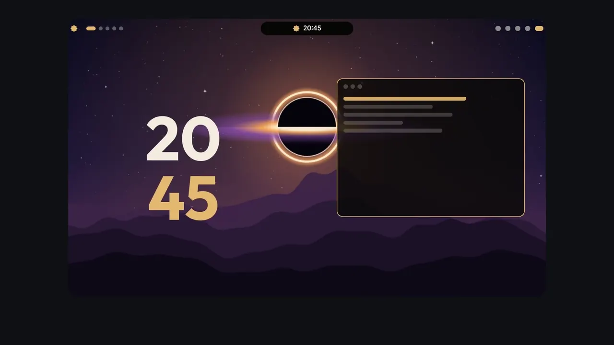

<p align="center">
  <b>English</b> · <a href="README.es.md">Español</a> · <a href="README.pt.md">Português</a>
</p>

<p align="center">
  
</p>

<p align="center">
  <b>A Hyprland and niri rice with its own Quickshell settings app, bar, launcher, desktop widgets and a dock.</b><br>
  Everything is configured with sliders and switches in one app. No config editing.<br>
  Original project by <a href="https://github.com/shadowww-dev/DarkShadowShell">shadowww-dev</a> (<a href="https://www.tiktok.com/@shadoww.dev">@shadoww.dev</a>) · Maintained fork: <a href="https://github.com/1Shad0w/DarkShadowShell">1Shad0w/DarkShadowShell</a>
</p>

<p align="center">
  <a href="docs/INSTALL.md#supported-systems"></a>
  <a href="docs/INSTALL.md#artix-linux-openrc-runit-s6-dinit"></a>
  <a href="docs/INSTALL.md#arch-linux-cachyos-endeavouros-garuda"></a>
  <a href="docs/INSTALL.md#fedora--nobara"></a>
  <a href="docs/INSTALL.md#gentoo"></a>
  <a href="docs/INSTALL.md#nixos"></a>
</p>
<p align="center">
  
  
  
</p>
<p align="center">
  <a href="https://github.com/1Shad0w/DarkShadowShell/releases/latest"></a>
  <a href="https://github.com/1Shad0w/DarkShadowShell/stargazers"></a>
  <a href="https://github.com/1Shad0w/DarkShadowShell/commits"></a>
  <a href="LICENSE"></a>
</p>

<p align="center">
  <a href="#quick-install">Install</a> ·
  <a href="docs/README.md">Docs</a> ·
  <a href="docs/FEATURES.md">Features</a> ·
  <a href="docs/KEYBINDS.md">Keybinds</a> ·
  <a href="docs/CUSTOMIZE.md">Customize</a> ·
  <a href="CONTRIBUTING.md">Contributing</a>
</p>

---

## See it in motion

<p align="center">
  <a href="https://github.com/shadowww-dev/DarkShadowShell/releases/download/v5.06/darkshadow-showcase.mp4">
    
  </a><br>
  <sub>The dock, widgets, presets, the Update Center and the modes. <a href="https://github.com/shadowww-dev/DarkShadowShell/releases/download/v5.06/darkshadow-showcase.mp4"><b>Watch the full video with sound (1:48)</b></a></sub>
</p>

## Supported systems

The shell runs on **Hyprland (0.55+)** and **niri (25.05+)**, and detects your distro automatically:

- **Arch-based**: Arch Linux, CachyOS, EndeavourOS, Garuda, Artix Linux (OpenRC, runit, s6, dinit)
- **Fedora-based**: Fedora, Nobara, and Fedora Atomic (Bazzite, Silverblue)
- **Gentoo** (OpenRC or systemd via `install/gentoo.sh`)
- **NixOS** (via the module in `nix/` or flake)

See the full compatibility table, WM flags (`--wm=hyprland|niri|both`), and distro notes in [docs/INSTALL.md](docs/INSTALL.md).

## Quick install

Install in one command (stable `main` or `dev` branch), or clone manually (avoid ZIP downloads so `rice-update` can keep it updated), then log out, choose **Hyprland** or **niri** on the login screen, and press `SUPER + U`:

```bash
# Stable (main)
curl -fsSL https://get.aurorian.es/dotfiles | bash

# Development (dev)
curl -fsSL https://get.aurorian.es/dotfiles-dev | bash
```

<details>
<summary>Manual git clone</summary>

```bash
git clone https://github.com/1Shad0w/DarkShadowShell shadows-shell && cd shadows-shell
# Optional: switch to dev branch -> git checkout dev
./install.sh
```

</details>

> **Updating:** Open **Settings → Update Center → Update now**, click an update notification, or run `rice-update` in a terminal.

## Highlights

- **Bar & Dynamic Island**: 9 bar styles (Dynamic, Flat, Floating, Islands, One island, Frame, etc.), autohide, drag-and-drop modules, and distro logo detection.
- **Desktop Widgets & Vibe**: Frosted-glass Material 3 widgets (clock, calendar, weather, music, lyrics, resources, visualizer, to-do, focus timer, notes) plus music-reactive Vibe effects.
- **Themes & Appearance**: 21 color schemes (wallpaper-adaptive Auto/Grey + curated palettes), 17 one-click preset styles, Material 3 SDDM login screen & lockscreen, and community themes via **Explore**.
- **Dock & Launcher**: Edge dock with app menu, pinned apps, and media controls; built-in DarkShadow Launcher with 5 themes, calculator, unit/currency converter, emoji picker, and file search.
- **Infinite Desktop & Touchpad Gestures**: Endless floating canvas (`SUPER + F`), continuous 2-finger pinch-to-zoom, and configurable 3/4-finger touchpad gestures.
- **System & Care**: Built-in screenshot editor & screen recorder, screen time stats, EasyEffects equalizer, profiles, window rules, and multi-distro **Update Center** with snapshot & cleanup tools.

Explore the full breakdown in [docs/FEATURES.md](docs/FEATURES.md) and all shortcuts in [docs/KEYBINDS.md](docs/KEYBINDS.md).

## Essential keybinds

| Keys | Action |
| --- | --- |
| `SUPER + U` | Open **Settings** |
| `ALT + Space` | DarkShadow Launcher |
| `SUPER + W` | Wallpaper picker |
| `SUPER + F` | Toggle Infinite Desktop |
| `SUPER + A` / `SUPER + N` | Control Center / Notifications |
| `SUPER + /` | View all keybinds |

Full reference (including niri equivalents): [docs/KEYBINDS.md](docs/KEYBINDS.md).

## Documentation

| Guide | Contents |
| --- | --- |
| **[Documentation Hub](docs/README.md)** | Simple index to all guides in English, Español, and Português |
| **[Installation](docs/INSTALL.md)** | Distro instructions, Hyprland vs. niri, installer flags, backups, updates |
| **[Features](docs/FEATURES.md)** | Complete feature reference by category |
| **[Keybinds](docs/KEYBINDS.md)** | All keyboard, mouse, and touchpad shortcuts |
| **[Customize](docs/CUSTOMIZE.md)** | CLI commands for bar, launcher, colors, notifications, lockscreen |
| **[Repo Layout](docs/LAYOUT.md)** | Directory structure and `sync.sh` workflow |
| **[Contributing](CONTRIBUTING.md)** | `dev` → `main` workflow, PR template, mandatory tests |
| **[Security](SECURITY.md)** | Threat model, hash-pinned downloads, opt-in online lookups |

## Credits & Thanks

- **shadowww-dev** ([shadowww-dev/DarkShadowShell](https://github.com/shadowww-dev/DarkShadowShell)): Creator and upstream maintainer of DarkShadow's Shell. This fork builds directly on his work.
- **Sarods2D** ([sarodscommits](https://github.com/sarodscommits)): **Infinite Desktop** is inspired by [hyprland-infinite-desktop-v2](https://github.com/sarodscommits/hyprland-infinitie-desktop-v2) (MIT), and the V3.23 Settings redesign took inspiration from his **Iridium** shell.
- **fedyaqq34356** ([hyprdots](https://github.com/fedyaqq34356/hyprdots)): Inspiration for the Dynamic bar island concept.

## License

MIT — see [LICENSE](LICENSE).
