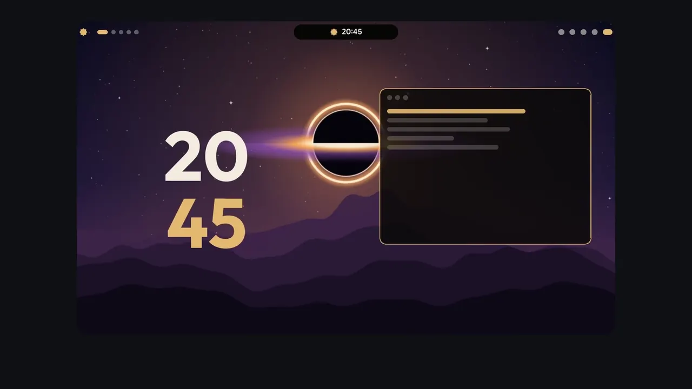

<p align="center">
  <a href="README.md">English</a> · <a href="README.es.md">Español</a> · <b>Português</b>
</p>

<p align="center">
  
</p>

<p align="center">
  <b>Um rice para Hyprland e niri com seu próprio app de Configurações em Quickshell, barra, lançador, widgets de desktop e dock.</b><br>
  Tudo é configurado com controles deslizantes e interruptores em um só app. Sem editar arquivos manualmente.<br>
  Projeto original de <a href="https://github.com/shadowww-dev/DarkShadowShell">shadowww-dev</a> (<a href="https://www.tiktok.com/@shadoww.dev">@shadoww.dev</a>) · Fork mantido: <a href="https://github.com/1Shad0w/DarkShadowShell">1Shad0w/DarkShadowShell</a>
</p>

<p align="center">
  <a href="docs/pt/INSTALL.md#sistemas-suportados"></a>
  <a href="docs/pt/INSTALL.md#artix-linux-openrc-runit-s6-dinit"></a>
  <a href="docs/pt/INSTALL.md#arch-linux-cachyos-endeavouros-garuda"></a>
  <a href="docs/pt/INSTALL.md#fedora--nobara"></a>
  <a href="docs/pt/INSTALL.md#gentoo"></a>
  <a href="docs/pt/INSTALL.md#nixos"></a>
</p>
<p align="center">
  
  
  
</p>
<p align="center">
  <a href="https://github.com/1Shad0w/DarkShadowShell/releases/latest"></a>
  <a href="https://github.com/1Shad0w/DarkShadowShell/stargazers"></a>
  <a href="https://github.com/1Shad0w/DarkShadowShell/commits"></a>
  <a href="LICENSE"></a>
</p>

<p align="center">
  <a href="#instalação-rápida">Instalar</a> ·
  <a href="docs/pt/README.md">Docs</a> ·
  <a href="docs/pt/FEATURES.md">Recursos</a> ·
  <a href="docs/pt/KEYBINDS.md">Atalhos</a> ·
  <a href="docs/pt/CUSTOMIZE.md">Personalizar</a> ·
  <a href="CONTRIBUTING.md">Contribuir</a>
</p>

---

## Em movimento

<p align="center">
  <a href="https://github.com/shadowww-dev/DarkShadowShell/releases/download/v5.06/darkshadow-showcase.mp4">
    
  </a><br>
  <sub>O dock, widgets, presets, a Central de atualizações e os modos. <a href="https://github.com/shadowww-dev/DarkShadowShell/releases/download/v5.06/darkshadow-showcase.mp4"><b>Assistir ao vídeo completo com som (1:48)</b></a></sub>
</p>

## Sistemas suportados

O shell funciona em **Hyprland (0.55+)** e **niri (25.05+)** e detecta sua distribuição automaticamente:

- **Baseados em Arch**: Arch Linux, CachyOS, EndeavourOS, Garuda, Artix Linux (OpenRC, runit, s6, dinit)
- **Baseados em Fedora**: Fedora, Nobara e Fedora Atomic (Bazzite, Silverblue)
- **Gentoo** (OpenRC ou systemd via `install/gentoo.sh`)
- **NixOS** (via módulo em `nix/` ou flake)

Veja a tabela completa de compatibilidade, opções de gerenciador (`--wm=hyprland|niri|both`) e notas por distro em [docs/pt/INSTALL.md](docs/pt/INSTALL.md).

## Instalação rápida

Clone o repositório (evite baixar o ZIP para que o `rice-update` possa atualizar), execute `./install.sh`, encerre a sessão, escolha **Hyprland** ou **niri** na tela de login e pressione `SUPER + U`:

```bash
git clone https://github.com/1Shad0w/DarkShadowShell shadows-shell && cd shadows-shell
./install.sh
```

> **Atualizar:** Abra **Configurações → Central de atualizações → Atualizar agora**, clique na notificação de atualização ou execute `rice-update` no terminal.

## Destaques

- **Barra & Ilha Dinâmica**: 9 estilos de barra (Dynamic, Flat, Floating, Islands, One island, Frame, etc.), ocultação automática, módulos arrastáveis e logo da sua distro.
- **Widgets & Vibe**: Widgets translúcidos Material 3 (relógio, calendário, clima, música, letras, recursos, visualizador de áudio, tarefas, timer de foco e notas) além de efeitos Vibe reativos à música.
- **Temas & Aparência**: 21 esquemas de cores (Auto/Cinza adaptativos ao papel de parede + paletas curadas), 17 estilos em um clique, tela de login SDDM e bloqueio em Material 3, e temas da comunidade em **Explorar**.
- **Dock & Lançador**: Dock na borda com menu de apps, apps fixados e controles de mídia; lançador integrado com 5 temas, calculadora, conversor de unidades/moedas, seletor de emojis e busca de arquivos.
- **Infinite Desktop & Gestos no Touchpad**: Tela flutuante infinita (`SUPER + F`), zoom contínuo com pinça de 2 dedos e gestos configuráveis de 3 e 4 dedos no touchpad.
- **Sistema & Care**: Editor de capturas e gravador de tela integrados, tempo de tela, equalizador EasyEffects, perfis, regras de janela e **Central de atualizações** multi-distro com snapshots e limpeza.

Veja todos os recursos em [docs/pt/FEATURES.md](docs/pt/FEATURES.md) e todos os atalhos em [docs/pt/KEYBINDS.md](docs/pt/KEYBINDS.md).

## Atalhos essenciais

| Teclas | Ação |
| --- | --- |
| `SUPER + U` | Abrir **Configurações** |
| `ALT + Space` | DarkShadow Launcher |
| `SUPER + W` | Seletor de papel de parede |
| `SUPER + F` | Alternar Infinite Desktop |
| `SUPER + A` / `SUPER + N` | Central de controle / Notificações |
| `SUPER + /` | Ver todos os atalhos |

Referência completa (incluindo equivalentes no niri): [docs/pt/KEYBINDS.md](docs/pt/KEYBINDS.md).

## Documentação

| Guia | Conteúdo |
| --- | --- |
| **[Central de Documentação](docs/pt/README.md)** | Índice simples de todos os guias em English, Español e Português |
| **[Instalação](docs/pt/INSTALL.md)** | Instruções por distro, Hyprland vs. niri, flags do instalador, backups e atualizações |
| **[Recursos](docs/pt/FEATURES.md)** | Referência completa de recursos por categoria |
| **[Atalhos](docs/pt/KEYBINDS.md)** | Todos os atalhos de teclado, mouse e touchpad |
| **[Personalizar](docs/pt/CUSTOMIZE.md)** | Comandos CLI para barra, lançador, cores, notificações e bloqueio |
| **[Estrutura do Repo](docs/pt/LAYOUT.md)** | Estrutura de diretórios e fluxo com `sync.sh` |
| **[Contribuir](CONTRIBUTING.md)** | Fluxo `dev` → `main`, modelo de PR e testes obrigatórios |
| **[Segurança](SECURITY.md)** | Modelo de segurança, downloads verificados por hash e consultas opt-in |

## Créditos e agradecimentos

- **shadowww-dev** ([shadowww-dev/DarkShadowShell](https://github.com/shadowww-dev/DarkShadowShell)): Criador e mantenedor original do DarkShadow's Shell. Este fork é construído diretamente sobre o trabalho dele.
- **Sarods2D** ([sarodscommits](https://github.com/sarodscommits)): O **Infinite Desktop** é inspirado no [hyprland-infinite-desktop-v2](https://github.com/sarodscommits/hyprland-infinitie-desktop-v2) (MIT), e o redesign de Configurações na V3.23 foi inspirado no shell **Iridium**.
- **fedyaqq34356** ([hyprdots](https://github.com/fedyaqq34356/hyprdots)): Inspiração para o conceito da ilha dinâmica da barra.

## Licença

MIT — veja [LICENSE](LICENSE).
